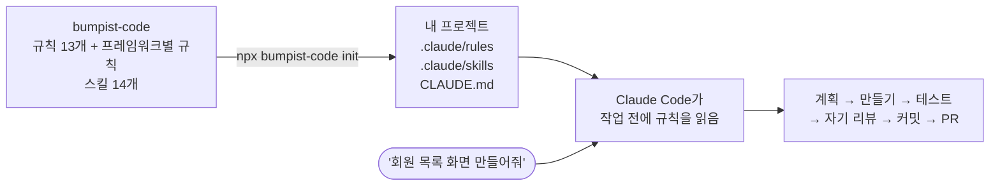
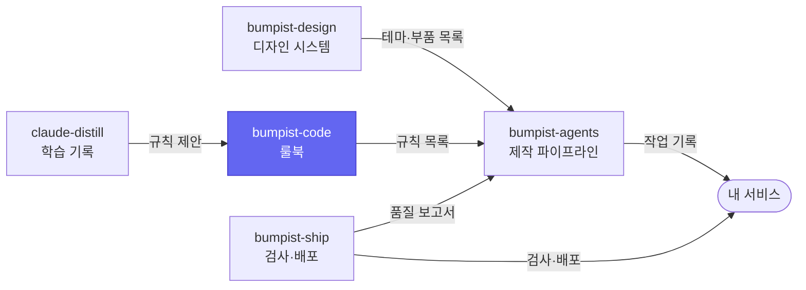

<p align="center">
  
</p>

<p align="center">
  <a href="https://github.com/parksubeom/bumpist-code/actions/workflows/ci.yml"></a>
  <a href="https://www.npmjs.com/package/bumpist-code"></a>
  
  
</p>

# bumpist-code

**AI에게 화면을 맡겨도, 프로젝트마다 같은 구조와 같은 품질로 나오게 하는 프론트엔드 룰북이에요.**

AI에게 "화면 만들어줘"라고만 하면 매번 폴더 배치도, 컴포넌트 작성법도, 테스트도 제각각으로 나와요. bumpist-code는 폴더 구조, 컴포넌트, 테스트, 커밋에 대한 규칙을 Claude Code가 작업 전에 읽는 형태로 넣어 둬요. 규칙을 외울 필요 없이 하고 싶은 일을 말로 시키면 돼요.

```sh
npx bumpist-code@latest init
```

필요한 건 Node 18 이상과 [Claude Code](https://claude.com/claude-code)뿐이에요. 별도 계정, 서버, 설정은 없어요.

<sub><a href="./비개발자-가이드.md">개발이 처음이라면 쉬운 설명부터</a> · <a href="./README.en.md">English</a> · <a href="./glossary.md">용어집</a></sub>

> **지금 상태 — npm v0.5.1.** Vue · React · Next.js 세 가지 프레임워크, Claude 스킬 14개. 실서비스 [re-pin](https://github.com/parksubeom/re-pin)으로 검증했어요. main에는 규칙 번호(아래 [규칙 번호](#규칙-번호))가 새로 들어갔고, 다음 npm 버전에 포함돼요.

## 어떤 문제를 푸나요

| 지금까지 | bumpist-code를 쓰면 |
| --- | --- |
| 프로젝트마다 폴더 구조와 코드 스타일이 달라요 | 모든 프로젝트가 같은 구조(Feature-Sliced Design)와 같은 작성법을 따라요 |
| AI가 필요 없는 패키지를 깔거나 설정을 마음대로 바꿔요 | 하지 말아야 할 일 목록을 먼저 읽고 시작해요 |
| 테스트와 커밋 정리는 매번 사람이 챙겨야 해요 | "커밋 정리해줘"라고 말하면 검사부터 커밋 메시지까지 같은 절차로 해요 |
| 실전에서 밟은 함정을 다음 프로젝트에서 또 밟아요 | 밟은 함정은 규칙으로 고쳐서 다음 버전에 넣어요 |

## 어떻게 동작하나요



규칙과 스킬은 내 프로젝트로 **복사**돼요. 그래서 이 저장소에 묶이지 않고, 받은 시점의 버전이 프로젝트에 그대로 남아요. 최신 규칙으로 바꾸고 싶으면 `init`을 다시 실행하면 돼요.

## 이게 맞는 도구인지

모두를 위한 도구가 아니라, 특정 방식을 지지하는 표준이에요.

| 경우 | 판단 |
| --- | --- |
| Claude Code로 프론트엔드를 맡기는데, 프로젝트가 늘수록 구조와 품질이 들쭉날쭉한 팀이나 개인. Vue · React · Next.js(App Router)와 TypeScript를 써요 | 잘 맞아요 |
| 이미 코드가 있는 프로젝트 | 규칙과 스킬 문서만 복사하고 빌드·패키지 설정은 건드리지 않아요. 붙였다 떼기 쉬워요 |
| 새 프로젝트를 처음부터 세우는 경우 | `setup-fe-project`는 pnpm + Turborepo + Feature-Sliced Design을 깔아요. 이 조합이 싫으면 이 스킬만 안 쓰면 돼요 |
| Claude Code를 안 쓰거나, Angular · Svelte · Solid를 쓰거나, 이미 팀 표준이 확고한 경우 | 맞지 않아요 |

## 써 보기

### 이미 코드가 있는 프로젝트에 붙이기

기존 코드는 건드리지 않고 규칙과 스킬만 추가돼요.

```sh
cd 내프로젝트
npx bumpist-code@latest init vue     # vue | react | next (생략하면 package.json에서 자동 감지)
git add .claude docs/ai CLAUDE.md && git commit -m "chore: adopt bumpist-code guide"
```

- `.claude/skills`, `.claude/rules`, `docs/ai`가 복사되고, 받은 버전이 `.claude/.guide-version`에 기록돼요.
- `CLAUDE.md`가 없으면 만들고, 있으면 추가할 줄만 알려줘요.
- 그다음 Claude Code를 열고 "기능 계획 잡아줘"라고 말해 보세요.

### 새 프로젝트를 처음부터

빈 폴더에서 위의 `init`을 먼저 실행한 뒤, Claude Code에 **"새 프로젝트 셋업해줘"**라고 말해요. 프레임워크를 확인하고 모노레포, 검사 도구, 테스트 도구를 세운 뒤 예시 버튼과 예시 화면을 심어요. 끝나면 이렇게 확인해요.

```sh
pnpm install && pnpm run lint && pnpm run type-check && pnpm run test && pnpm run build
```

### 팀원과 업데이트

- 팀원은 프로젝트를 `git clone`하기만 하면 돼요. 규칙이 프로젝트에 같이 커밋돼 있어요.
- 최신 규칙은 `npx bumpist-code@latest init <프레임워크>`를 다시 실행해서 받아요. 자동으로 바뀌지는 않아요.
- 특정 버전을 고정하려면 `npx bumpist-code@0.5.1 init vue`처럼 버전을 적어요.

## 말로 시키면 붙는 스킬

규칙을 찾아볼 필요 없이, 하려는 일을 말하면 알맞은 스킬이 붙어요.

| 이렇게 말하면 | 붙는 스킬 |
| --- | --- |
| "이거 어떻게 시작하지?" | `dev-workflow` |
| "이 기능 계획부터 잡아줘" | `plan-feature` |
| "새 프로젝트 셋업해줘" | `setup-fe-project` |
| "버튼 컴포넌트 만들어줘" | `create-component` |
| "이 Figma 화면 구현해줘" | `implement-from-figma` |
| "회원 목록 화면 추가해줘" | `create-slice` |
| "API 타입 다시 만들어줘" | `gen-api-types` |
| "디자인 토큰 갱신해줘" | `gen-tokens` |
| "테스트 붙여줘" | `write-test` |
| "이게 안 돼요" | `debug-issue` |
| "이 결정 기록해줘" | `create-adr` |
| "변경 사항 리뷰해줘" | `review-changes` |
| "커밋 정리해줘" | `prepare-commit` |
| "PR 올려줘" | `prepare-pr` |

## 규칙 번호

규칙마다 바뀌지 않는 번호가 붙어요(예: `CORE-001`). 리뷰 코멘트, 자동 검사 실패, 회고가 모두 이 번호로 규칙을 가리키기 때문에, 어떤 규칙이 자주 깨지는지 셀 수 있어요.

```md
<!-- rule: CORE-001 | severity: error | enforce: review -->
- 명시되지 않은 패키지, 설정을 임의로 추가하지 않는다.
```

- 번호는 규칙 문서 안에 보이지 않는 주석으로 달려 있어요. 문서를 읽는 사람에게는 달라 보이지 않아요.
- `node scripts/build-rules-index.mjs`가 번호를 모아 [`rules.json`](https://parksubeom.github.io/bumpist-code/rules.json)을 만들어요. 다른 도구는 이 파일로 규칙을 읽어요.
- 번호만 고치고 `rules.json`을 다시 만들지 않으면 자동 검사(`rules-index`)가 막아요.
- **진행 상황:** `10-guardrails`의 규칙 18개(CORE-001~018)에 번호가 붙었고, 나머지 규칙 문서는 차례로 붙이는 중이에요. 방법은 [docs/rule-ids.md](./docs/rule-ids.md)에 있어요.

## 실전 사례 — re-pin

[re-pin](https://github.com/parksubeom/re-pin)은 외주 디자인 작업의 수정 요청을 핀으로 찍어 관리하는 서비스예요. 빈 저장소에서 시작해 Supabase 저장·로그인·보안 점검까지 이 룰북 위에서 완주했어요. 그 과정에서 Next.js 트랙의 함정 세 개가 실제로 터졌고, 모두 v0.5.1 규칙으로 돌아왔어요.

| 실전에서 터진 것 | 원인 | 규칙에 반영한 것 |
| --- | --- | --- |
| 첫 빌드가 깨짐 | Next.js가 `src/pages`를 예약해 FSD의 `pages` 레이어와 충돌 | 화면 레이어 이름을 `pageViews`로 변경 |
| 커밋 훅이 깨짐 | Next.js 기본 ESLint 설정이 ESLint 9 + pnpm에서 파일 단위 검사를 깨뜨림 | `typescript-eslint` 기본 설정으로 교체 |
| 테스트가 엉뚱한 파일을 읽음 | 테스트 도구가 `.claude/` 안의 템플릿까지 수집 | 세 트랙 모두 `src`만 수집하도록 제한 |

프로젝트 안에서 우회하고 끝내지 않고 룰북에 반영해서, 다음 프로젝트는 같은 함정을 처음부터 밟지 않아요. 이게 이 룰북이 버전을 올리는 방식이에요.

## 디자인 기준

기본 디자인 기준은 [bumpist-design](https://github.com/parksubeom/bumpist-design)의 디자인 원칙으로 옮겨 가는 중이에요. 지금의 [`rules/30-design.md`](./rules/30-design.md)는 이전 기준(뉴트럴한 바탕에 브랜드 색 하나, 플랫한 화면)이고, bumpist-design v0.1과 함께 새 원칙(UI-003~011)으로 다시 써요. 디자인 토큰이 있는 프로젝트에서는 언제나 토큰이 최종 기준이에요.

미감을 더 끌어올리고 싶다면 [impeccable](https://github.com/pbakaus/impeccable)을 함께 쓸 수 있어요(`npx impeccable install`).

## 버전 관리

npm에 [semver](https://semver.org/lang/ko/)로 배포해요. 복사 방식이라 원하는 버전을 골라 받고, 받은 버전은 다시 실행하기 전까지 바뀌지 않아요.

| 올라가는 자리 | 언제 |
| --- | --- |
| MAJOR | 규칙 삭제, 이름·경로 변경처럼 깨지는 변경 |
| MINOR | 새 규칙·스킬 추가, 규칙 보강 |
| PATCH | 문구, 오타, 작은 수정 |

지금 프로젝트의 버전은 `cat .claude/.guide-version`으로 볼 수 있어요. 변경 이력은 [CHANGELOG.md](./CHANGELOG.md)에 있어요.

<details>
<summary><b>규칙 목록</b> — 공통 13개와 프레임워크별 규칙</summary>

**공통 (`rules/*.md`)** — Vue · React · Next.js 모두에 적용돼요.

| 파일 | 내용 |
| --- | --- |
| `00-core.md` | 스택, 작업 기본 원칙, 명령어 |
| `05-working-with-claude.md` | Claude와 협업하는 법 — 범위 확인, 검증, 정직한 보고 |
| `10-guardrails.md` | 임의 생성·변경·삭제 금지선 |
| `15-working-sessions.md` | 작업 세션 — 계획 먼저, 맥락 얇게, 자율성과 안전의 균형 |
| `20-project-structure.md` | 모노레포 배치와 FSD 계층 |
| `30-design.md` | 디자인 원칙 (bumpist-design 기준으로 개편 예정) |
| `35-accessibility.md` | 접근성 — 시맨틱, 키보드, 폼, 모달, 대비 |
| `37-figma-to-code.md` | Figma 디자인을 토큰과 컨벤션에 맞춰 옮기기 |
| `40-api-types.md` | openapi-typescript로 API 타입 만들기 |
| `50-testing-quality.md` | 테스트 3층, 검증 절차, 커밋 훅 |
| `70-git-and-reviews.md` | 브랜치 정책, PR, 코드 리뷰 |
| `80-security-and-secrets.md` | 시크릿, 환경변수, 의존성 보안 |
| `90-ci.md` | 자동 검사 단계 |

**프레임워크별 (`rules/vue/`, `rules/react/`, `rules/next/`)**

| 파일 | Vue | React | Next.js (App Router) |
| --- | --- | --- | --- |
| `code-style.md` | SFC, `interface Props`, cva/cn | 함수 컴포넌트 + 훅, cva/cn | React + 서버/클라이언트 경계 |
| `state-and-data.md` | Pinia + Vue Query | Zustand + React Query | RSC fetch + Query + Server Action |
| `i18n.md` | vue-i18n | react-i18next | next-intl |
| `error-handling.md` | 토스트 규약 | Error Boundary + 토스트 | `error.tsx` 경계 + 토스트 |
| `routing.md` | — | — | App Router 파일 규약 |
| `project-structure.md` | — | — | FSD × `app/` 재조정 |

</details>

<details>
<summary><b>스택</b> — 세 트랙이 쓰는 기술</summary>

- **공통:** TypeScript strict · TanStack Query · openapi-typescript · Tailwind v4 + cva/cn + 디자인 토큰 · Feature-Sliced Design · pnpm + Turborepo · Vitest + Playwright + Storybook · oxlint + ESLint + Prettier + commitlint + husky
- **Vue:** Vite · Vue Router · Pinia · Vue Query · vue-i18n · @vue/test-utils
- **React:** Vite · React Router · Zustand · React Query · react-i18next · React Testing Library
- **Next.js:** App Router · RSC fetch + Server Action · Zustand · React Query · next-intl · React Testing Library

새 패키지는 임의로 추가하지 않고, 필요성·대안·번들 영향을 밝히고 승인받아요(`rules/10`).

</details>

<details>
<summary><b>참고 템플릿</b> — <code>docs/ai/</code></summary>

- [`error-toast-template.md`](./docs/ai/error-toast-template.md) — API 오류를 토스트로 보여주는 패턴
- [`pr-review-checklist.md`](./docs/ai/pr-review-checklist.md) — PR 본문과 리뷰 체크리스트
- [`ci-workflow-template.md`](./docs/ai/ci-workflow-template.md) — pnpm + Turborepo용 GitHub Actions 예시

</details>

## Bumpist Suite 안에서

다섯 저장소는 서로의 코드를 가져다 쓰지 않고, 정해진 형식의 파일만 주고받아요. 그래서 하나만 골라 써도 되고, 모두 연결해 쓸 수도 있어요. 색칠된 칸이 이 저장소예요.

| 저장소 | 한 줄 설명 |
| --- | --- |
| [bumpist-design](https://github.com/parksubeom/bumpist-design) | 서비스마다 색만 바꾸면 되는 디자인 시스템 |
| [bumpist-agents](https://github.com/parksubeom/bumpist-agents) | 아이디어에서 미리보기 링크까지 가는 Claude Code 작업 순서 |
| [bumpist-code](https://github.com/parksubeom/bumpist-code) | AI가 매번 같은 방식으로 코드를 쓰게 하는 룰북 |
| [bumpist-ship](https://github.com/parksubeom/bumpist-ship) | 파일 하나로 붙이는 자동 검사·배포 |
| [claude-distill](https://github.com/parksubeom/claude-distill) | Claude가 대화에서 배운 것을 자동으로 기록 |



제품군 전체에 걸친 결정 기록은 [docs/suite](./docs/suite/README.md)에 있어요.

## 기여

버그를 밟았거나(어느 트랙·버전·재현 방법) 여러 프로젝트에 두루 쓸 규칙 아이디어가 있으면 [이슈](https://github.com/parksubeom/bumpist-code/issues)부터 열어 주세요. 한 프로젝트에서만 쓰는 규칙은 받지 않아요. 그건 각 프로젝트의 `.claude/`에 두세요. 흐름과 커밋 규약은 [CONTRIBUTING.md](./CONTRIBUTING.md)에 있어요.

## 라이선스

MIT
